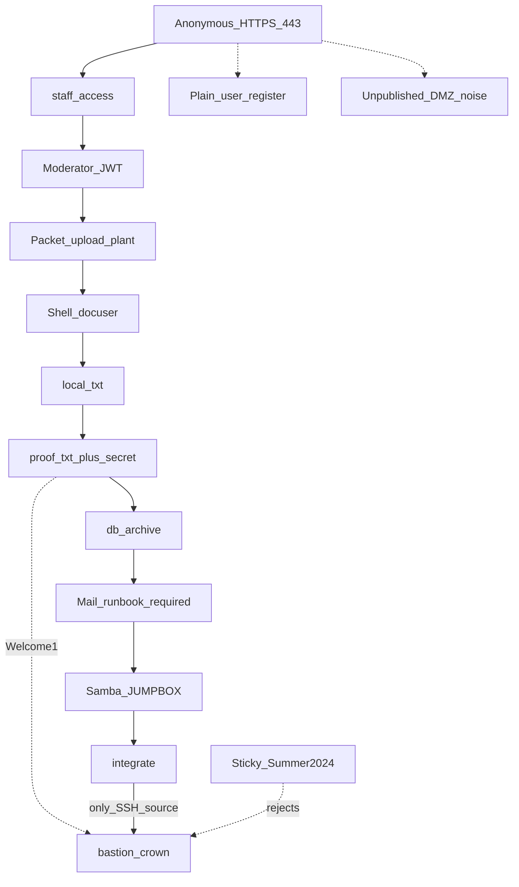

# Cycle-10 — `v1.10.0` attack graph

**Authority:** [box plan](../security/Cycle-10/Dev/v1.10.0-box-plan.md) · [ground truth](../security/Cycle-10/Dev/v1.10.0-ground-truth.md)

**Hard gates:** packets need moderator · bastion TCP only from `integrate` · bastion secret needs `docproc` root · host publish HTTPS `:443` only.
