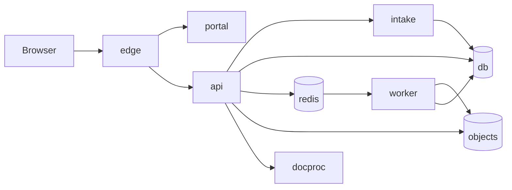

# Cycle-10 — SoftDev dependency graph (`v1.10.0`)

Product call graph (SUPPORT path — must work for the platform):

Corporate / ops dependencies: `integrate` → `files` / `api`; `backup` → `db` / repo; employees → `id` / `mail` / `files` via DNS.
