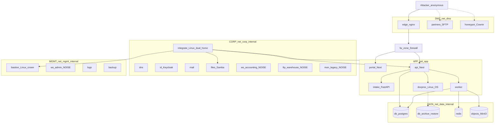

# Cycle-10 — `v1.10.0` topology (insecure tip)

**Pair:** intentional insecure **`v1.10.0`** → hardened **`v2.10.0`** ([ADR-039](../decisions/ADR-039-cycle-10-enterprise-pair.md))  
**Authority:** [cycle-10-decisions.md](../security/Cycle-10/Dev/cycle-10-decisions.md) · [v1.10.0-summary.md](../security/Cycle-10/Dev/v1.10.0-summary.md)  
**Compose (target):** one lab entrypoint `infra/docker-compose.cycle10-lab.yml` (product + lab hosts). Secure tip later uses product-only compose.

DNS names use `*.northwind.lab` on internal resolvers. Only **DMZ** services are published to the attacker host.

---

## Zones



---

## Host cards

| DNS / service | Zone | Tag | Published | Role |
|---------------|------|-----|-----------|------|
| `edge.northwind.lab` | DMZ | LIVE entry | HTTPS (weak on v1.10) | nginx TLS terminate + route |
| `partners.northwind.lab` | DMZ | LIVE debt / side | SFTP | Legacy partner transfer — cannot skip web gate |
| `honeypot.northwind.lab` | DMZ | DECOY | SSH-looking | Cowrie — timebox |
| `portal.northwind.lab` | APP | SUPPORT | via edge | Next UI |
| `api.northwind.lab` | APP | SUPPORT + plant | via edge | Nest BFF + packet API |
| `intake.northwind.lab` | APP | SUPPORT | internal | FastAPI HR (unchanged closed plants) |
| `worker.northwind.lab` | APP | SUPPORT | internal | Async jobs |
| `docproc.northwind.lab` | APP | **LIVE OS** | none | Helper + first shell / `local` / `proof` |
| `db.northwind.lab` | DATA | SUPPORT | none | Primary Postgres |
| `db-archive.northwind.lab` | DATA | **LIVE debt** | none | Forgotten restore |
| `redis` / `objects` | DATA | SUPPORT | none | Queue / object store |
| `dns` / `id` | CORP | SUPPORT | none | DNS + Keycloak-style IdP (**not graded**) |
| `mail.northwind.lab` | CORP | **LIVE** | none | Required intel |
| `files.northwind.lab` | CORP | **LIVE** | none | Samba dept share |
| `integrate.northwind.lab` | CORP+APP | **LIVE OS** | none | Dual-home; **only host allowed to bastion** |
| `bastion.northwind.lab` | MGMT | **LIVE crown** | none | Admin jump |
| `ws-accounting` / `ftp-warehouse` / `mon-legacy` / `ws-admin` | CORP/MGMT | NOISE | none | Realistic clutter |
| `logs` / `backup` / `fw` | MGMT | SUPPORT | none | Ops + zone firewall |

---

## Graded path overlay

```text
edge → hidden public dir → moderator session → packet upload
  → docproc helper RCE → local → proof (root)
  → db-archive → mail (required) → files → integrate
  → bastion (only from integrate + secret after docproc root) → crown
```

**Hard gates:** plain `user` → 403 on packets · bastion TCP only from `integrate` · bastion secret requires `docproc` root.

---

## Firewall highlights (insecure)

| From | To | Allow |
|------|-----|-------|
| Internet | edge, partners, honeypot | Published ports only |
| edge | portal, api | HTTP upstreams |
| api | intake, worker, db, redis, objects, docproc | App dependencies |
| docproc | db-archive | **Exception** (intel) |
| integrate | bastion | **Only** admin path to crown |
| Most other cross-zone | * | **Deny** |

Secure `v2.10.0` removes lab exceptions and LIVE OS plants; topology *shape* remains.

---

## Related

| Doc | Role |
|-----|------|
| [c10-v1.10.0-attack-graph.md](c10-v1.10.0-attack-graph.md) | Graded compromise DAG |
| [c10-v1.10.0-dependency-graph.md](c10-v1.10.0-dependency-graph.md) | SoftDev product call graph |
| [c10-v1.10.0-auth-flow.md](c10-v1.10.0-auth-flow.md) | Access request → moderator → packets |
| [v1.10.0-reachability-matrix.md](../security/Cycle-10/Dev/v1.10.0-reachability-matrix.md) | Firewall allow/deny matrix |
| [Cycle-10 Dev](../security/Cycle-10/Dev/README.md) | Full v1.10 design pack |
