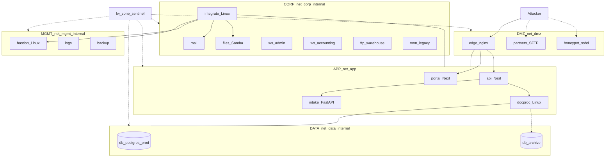

# Cycle-10 — `v1.10.0` topology (insecure tip)

**Pair:** intentional insecure **`v1.10.0`** → hardened **`v2.10.0`** ([ADR-039](../decisions/ADR-039-cycle-10-enterprise-pair.md))  
**Authority:** [cycle-10-decisions.md](../security/Cycle-10/Dev/cycle-10-decisions.md) · [HOST-INVENTORY.md](../../infra/cycle10/HOST-INVENTORY.md)  
**Compose:** `infra/docker-compose.prod.yml` + `infra/docker-compose.cycle10-lab.yml`

DNS: `*.northwind.lab` on Docker DNS. **Sole host publish:** edge HTTPS **`:443→443`**. Partners/honeypot stay on DMZ without HostPort (reachable only after foothold).

**Enforcement (SoftDev):** cross-zone deny is mostly **NIC membership** + `internal: true` on DATA/CORP/MGMT + bastion INPUT iptables. `fw` holds FORWARD default-DROP (bridges ≠ allowlist; same-bridge peers do not traverse fw).

---

## Zones



**SoftDev notes:** `dns` / `id` (Keycloak-style) / `worker` / `redis` / `objects` remain design-optional — not required for the graded path. Product `postgres` stays on prod `dbnet`; `db-archive` is the lab restore on `net_data`.

---

## Host cards

| DNS / service | Zone(s) | Published | Role |
|---------------|---------|-----------|------|
| `edge.northwind.lab` | DMZ+APP | **`:443→443`** HTTPS (weak) | TLS terminate; static `/` + proxy portal/api — **only host face** |
| `partners.northwind.lab` | DMZ | none | Partner SFTP theater — unpublished; cannot skip web gate |
| `honeypot.northwind.lab` | DMZ | none | SSH decoy on DMZ — unpublished (not Cowrie/external) |
| `portal.northwind.lab` | APP | via edge | Next UI |
| `api.northwind.lab` | APP | via edge | Nest + packets API |
| `intake` | APP (prod nets) | via api BFF | FastAPI HR |
| `docproc.northwind.lab` | APP+DATA | none | Helper + local/proof |
| `db-archive.northwind.lab` | DATA | none | Stale restore |
| `mail.northwind.lab` | CORP | none | Ops thread + runbook |
| `files.northwind.lab` | CORP | none | Samba dept share |
| `integrate.northwind.lab` | APP+CORP+MGMT | none | Jump host; **only** bastion SSH source |
| `bastion.northwind.lab` | MGMT | none | Crown |
| `ws-admin.northwind.lab` | CORP | none | Helpdesk sticky-note (not on MGMT) |
| `ws-accounting` / `ftp-warehouse` / `mon-legacy` | CORP | none | Extra corp hosts |
| `logs` / `backup` | MGMT | none | Collectors |
| `fw.northwind.lab` | all NICs | none | Zone sentinel (FORWARD DROP baseline) |

---

## Graded path overlay

```text
edge → HTML comment → /staff-access/ → moderator → packet upload
  → docproc helper RCE → local → proof (root)
  → db-archive → mail (required) → files → integrate
  → bastion (only from integrate + secret after docproc root) → crown
```

**Hard gates:** plain `user` → packets 403 · bastion TCP only from `integrate` · bastion secret requires `docproc` root · **host publish HTTPS `:443` only** · docuser cannot read `/root/proof.txt` / shadow without PrivEsc.

---

## Firewall / isolation highlights

| From | To | How allowed |
|------|-----|-------------|
| Internet | edge HTTPS `:443` | Host publish only |
| Internet | partners / honeypot / APP… | **Deny** (no HostPort) |
| edge | portal / api | Shared `net_app` |
| api | docproc | Shared `net_app` (`DOCPROC_URL`) |
| docproc | db-archive | Shared `net_data` (**exception**) |
| integrate | bastion `:22` | Shared `net_mgmt` + bastion INPUT allowlist |
| ws-admin → bastion | — | **Deny** (no MGMT NIC / no DNS) |
| Internet → APP/DATA/CORP/MGMT | — | **Deny** (`internal` + no publish) |

Secure `v2.10.0` removes lab exceptions and LIVE OS plants; zone *shape* remains.

---

## Related

| Doc | Role |
|-----|------|
| [c10-v1.10.0-attack-graph.md](c10-v1.10.0-attack-graph.md) | Graded compromise DAG |
| [c10-v1.10.0-dependency-graph.md](c10-v1.10.0-dependency-graph.md) | SoftDev product call graph |
| [c10-v1.10.0-auth-flow.md](c10-v1.10.0-auth-flow.md) | Access request → moderator → packets |
| [v1.10.0-reachability-matrix.md](../security/Cycle-10/Dev/v1.10.0-reachability-matrix.md) | Allow/deny matrix |
| [Cycle-10 Dev](../security/Cycle-10/Dev/README.md) | Full v1.10 design pack |
